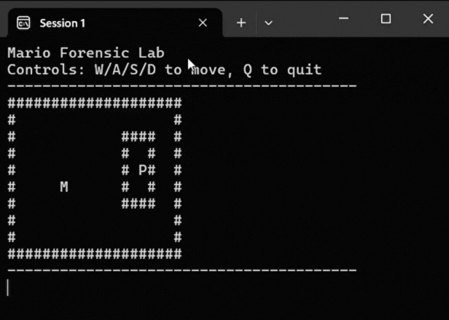

# 🕹️ Hướng Dẫn — Session 1: Khởi Tạo Bản Đồ & Logic Di Chuyển

Tài liệu này dành cho các bạn chưa tham gia và muốn tìm hiểu cũng như hoàn thiện nội dung của **Session 1**. Hãy làm theo các bước dưới đây để tạo ra sản phẩm ban đầu và nắm vững logic nền tảng trước khi bước vào **Session 2**.

---

## 🎯 1. Kết Quả Cần Đạt Của Session 1 (Output)

Kết thúc Session 1, bạn cần chạy được một chương trình C hiển thị bản đồ dạng lưới (ma trận) ngay trên màn hình Console với các thành phần:

- **`M`**: Vị trí của Mario (nhân vật chính).
- **`P`**: Vị trí của Công chúa (Princess).
- **`#`**: Các bức tường bao quanh bản đồ và lồng giam bảo vệ Công chúa.
- Người chơi có thể dùng các phím **W / S / A / D** để điều khiển Mario di chuyển từng ô trên bàn cờ mà không đi xuyên qua tường `#` hay ra khỏi bản đồ.



---

## 🤖 2. Cách Dùng AI Để Tạo Mã Nguồn

Để AI đóng vai trò như một lập trình viên hỗ trợ bạn dựng khung chương trình, hãy thực hiện lần lượt các thao tác sau:

1. Mở **Visual Studio Code**.
2. Chọn **File** $\rightarrow$ **Open Folder...** để mở thư mục dự án của bạn.
3. Tạo một file mới có tên: `mario-game.c`.
4. Mở cửa sổ **Agent Code View** (hoặc khung chat AI bạn đang sử dụng).
5. Sao chép và dán prompt mẫu dưới đây vào khung chat để AI sinh mã nguồn:

```text
Hãy viết và compile cho tôi một chương trình C mô phỏng game Mario giải cứu công chúa với các yêu cầu kỹ thuật sau:

BẢN ĐỒ:
- Bản đồ dạng lưới (grid) kích thước 20 cột x 10 hàng,
- Viền ngoài cùng của bản đồ là tường (ký tự '#'), không thể đi xuyên qua.
- Ô trống là khoảng trắng ' '.

Các nhân vật:
- Gồm hai nhân vật Mario (M) và Princess (P)
- Mỗi nhân vật được định nghĩa bởi vị trí x, y tương ứng trên bản đồ
- Mario: sinh ra tại một vị trí ngẫu nhiên bên trong bản đồ và đảm bảo không trùng hoặc nằm trong lồng chung với Princess
- Princess: bị "giam" trong một khu vực 3x3 có tường bao quanh trong bản đồ, Princess đứng yên

DI CHUYỂN:
- Cho phép người chơi di chuyển Mario bằng phím W/A/S/D
- Trước khi cập nhật vị trí của Mario, phải kiểm tra tường/biên
- Sau mỗi lần di chuyển, vẽ lại toàn bộ map

YÊU CẦU CODE STYLE:
- Tách riêng các hàm rõ ràng
- KHÔNG dùng biến global bừa bãi.
- Comment ngắn gọn cho các hàm và logic
- Không tối ưu hóa hay rút gọn code, ưu tiên code dễ đọc, dễ trace hơn là code ngắn gọn.


```

Sau khi AI tạo xong code, hãy chạy thử để chắc chắn nhân vật `M` đã có thể sinh ra ngẫu nhiên và thử di chuyển trên console bằng bốn phím W/S/A/D.

---

## 🔍 3. Hoạt Động "Giám Định Code"

Điểm cốt lõi của workshop không phải là copy code từ AI, mà là **hiểu và làm chủ logic đằng sau nó**.

Trong buổi học vừa rồi, các bạn trên lớp đã đóng vai trò là "Kiến trúc sư hệ thống" và sử dụng **Claude** như một trợ giảng để mổ xẻ, giải thích 2 cơ chế quan trọng:

1. **Cơ chế sinh ra ngẫu nhiên của Mario:**

- Thuật toán chọn tọa độ ban đầu cho Mario hoạt động như thế nào?
- Làm sao để đảm bảo Mario không xuất hiện đè lên tường `#`, trong lồng nhốt Công chúa hoặc ngay vị trí của Công chúa `P`?

2. **Logic di chuyển phím W / S / A / D:**

- Mỗi phím bấm làm thay đổi tọa độ $(x, y)$ trong mảng 2 chiều như thế nào?
- Logic "kiểm tra va chạm" (boundary & collision check) ngăn Mario đi xuyên tường hoặc rơi ra khỏi bản đồ hoạt động ra sao trước khi cập nhật vị trí mới?

Các bạn có thể tham khảo slide mà AI tạo ra để giải thích cách **Khởi tạo Bản đồ** ở [Giải thích cách khởi tạo bản đồ](../tech_slides/mario_forensic_lab_session1.pdf)

> **Thử thách dành cho bạn:** Hãy đưa đoạn code vừa tạo cho Claude, đặt câu hỏi để Claude giải thích một trong hai cơ chế trên bằng các hình ảnh trực quan. Hãy tự diễn giải lại được các logic này trước khi bước vào Session 2.
